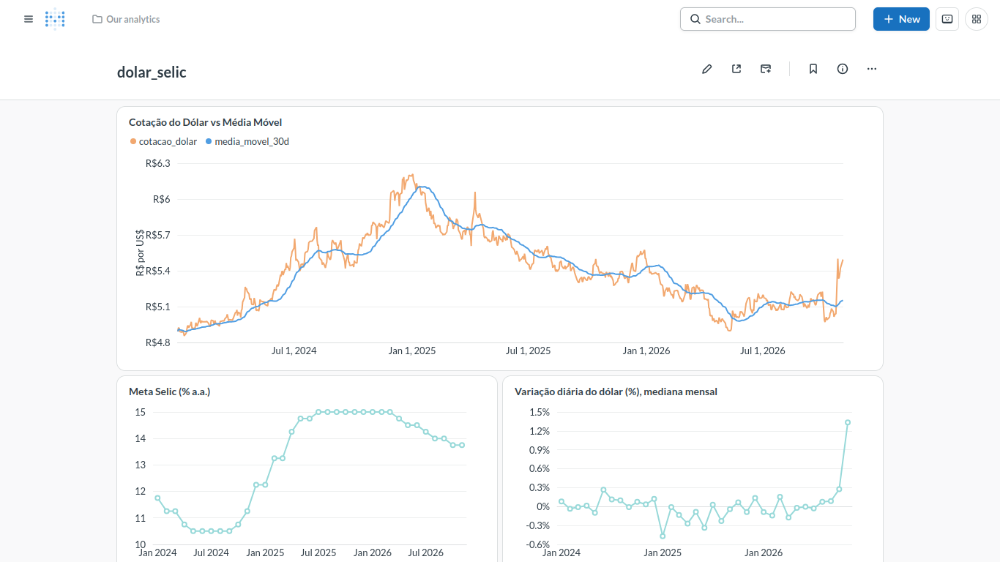
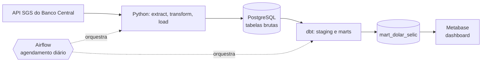
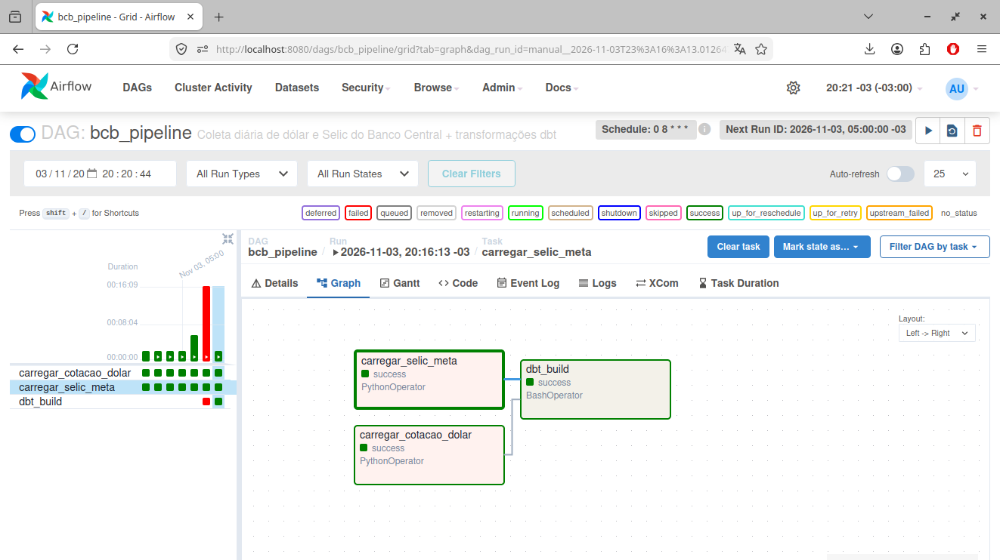
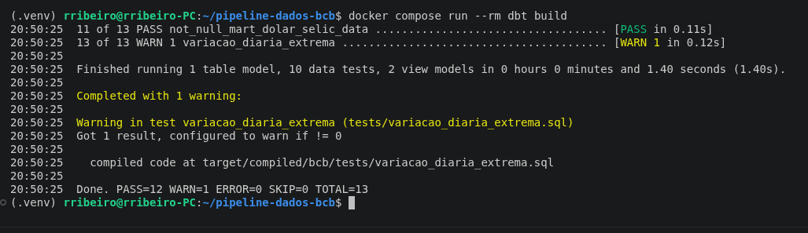

# Pipeline de Dados: Dólar e Selic (Banco Central do Brasil)

Pipeline de dados completo, de ponta a ponta, que coleta diariamente a **cotação do dólar** e a **meta da taxa Selic** na API pública do Banco Central, armazena em PostgreSQL, transforma os dados com dbt e os exibe em um dashboard no Metabase. Tudo é orquestrado pelo Apache Airflow e roda localmente com **um único comando**, usando apenas ferramentas gratuitas e open source.



## Sumário

- [Arquitetura](#arquitetura)
- [Stack](#stack)
- [Como funciona](#como-funciona)
- [Como rodar](#como-rodar)
- [Modelagem e qualidade de dados](#modelagem-e-qualidade-de-dados)
- [Decisões técnicas](#decisões-técnicas)
- [Estrutura do repositório](#estrutura-do-repositório)
- [Limitações e próximos passos](#limitações-e-próximos-passos)
- [Autor](#autor)

## Arquitetura



Fluxo diário da DAG `bcb_pipeline`:

```
carregar_cotacao_dolar ─┐
                        ├─→ dbt_build (modelos + testes)
carregar_selic_meta ────┘
```

As duas cargas rodam em paralelo. O `dbt_build` só executa se **ambas** terminarem com sucesso, para que o dashboard nunca seja alimentado com dados incompletos.



## Stack

| Camada | Ferramenta | Função |
|---|---|---|
| Linguagem | Python 3.14 | Extração, transformação e carga |
| Bibliotecas | requests, pandas, SQLAlchemy | Consumo da API, tratamento dos tipos e acesso ao banco |
| Banco de dados | PostgreSQL 16 | Armazenamento dos dados brutos e analíticos |
| Orquestração | Apache Airflow 2.10 | Agendamento, retentativas e monitoramento |
| Transformação | dbt-core e dbt-postgres 1.9 | Modelagem em camadas e testes de qualidade |
| Visualização | Metabase (open source) | Dashboard |
| Infraestrutura | Docker e Docker Compose | Ambiente reproduzível |

## Como funciona

**Fonte de dados:** API SGS do Banco Central, pública e sem chave de acesso.

| Série | Código SGS | Descrição |
|---|---|---|
| `cotacao_dolar` | 1 | Dólar americano (venda), diário |
| `selic_meta` | 432 | Meta da taxa Selic, em % ao ano |

**Pipeline em Python (`src/pipeline.py`):**

- `extract`: busca o período na API. A API responde `404` quando não há dados no intervalo (fins de semana, feriados), e esse caso é tratado como "nada novo", não como erro.
- `transform`: converte o JSON (tudo texto) para tipos corretos de data e número.
- `load`: grava com `INSERT ... ON CONFLICT (data) DO NOTHING`.
- **Carga incremental:** consulta a última data gravada e busca apenas os dias seguintes.
- **Idempotente:** executar uma, duas ou dez vezes produz o mesmo resultado, sem duplicar linhas.

## Como rodar

**Pré-requisitos:** Docker e Docker Compose. Reserve cerca de 4 GB de RAM livres (Airflow e Metabase são os maiores consumidores).

**1. Clone o repositório e crie o arquivo de ambiente**

```bash
git clone https://github.com/SEU_USUARIO/pipeline-dados-bcb.git
cd pipeline-dados-bcb
cp .env.example .env
```

**2. Suba os serviços**

```bash
docker compose up -d --build
```

A primeira execução demora alguns minutos (download das imagens e inicialização do Airflow e do Metabase).

**3. Dispare o pipeline no Airflow**

- Acesse http://localhost:8080 com o usuário `admin`.
- Obtenha a senha gerada:

```bash
docker compose exec airflow cat /opt/airflow/standalone_admin_password.txt
```

- Ative a DAG `bcb_pipeline` e clique em **Trigger**.

**4. Configure o Metabase** em http://localhost:3000

- Crie a conta de administrador local.
- Adicione um banco **PostgreSQL** com: host `postgres`, porta `5432`, banco `dados`, usuário `postgres`, senha `postgres`.
- Use a tabela `public_marts.mart_dolar_selic` para montar as visualizações.

> Todas as credenciais deste repositório são de **demonstração**, para ambiente local. Não use esses valores em produção.

### Serviços e portas

| Serviço | Porta | Observação |
|---|---|---|
| PostgreSQL (dados) | 5432 | Banco `dados` |
| Airflow | 8080 | Usuário `admin` |
| Metabase | 3000 | Configuração inicial no navegador |
| dbt | n/a | Executado sob demanda |

### Comandos úteis

```bash
# Rodar o pipeline em Python, fora do Airflow
docker compose run --rm pipeline

# Rodar as transformações e os testes do dbt
docker compose run --rm dbt build

# Parar tudo, mantendo os dados
docker compose down

# Parar e apagar todos os volumes (recomeça do zero)
docker compose down -v
```

## Modelagem e qualidade de dados

**Camadas do dbt:**

| Camada | Modelos | Materialização |
|---|---|---|
| Fontes | `cotacao_dolar`, `selic_meta` (schema `public`) | tabelas brutas |
| Staging | `stg_cotacao_dolar`, `stg_selic_meta` | view |
| Marts | `mart_dolar_selic` | tabela |

A tabela `mart_dolar_selic` reúne, por data: a cotação do dólar, a **média móvel de 30 dias úteis**, a **variação diária (%)** e a **meta Selic** vigente.

**Testes automatizados:**

- `not_null` e `unique` nas datas de todos os modelos.
- `not_null` nos valores de cotação e Selic.
- Teste singular: cotação do dólar deve ser positiva.
- Teste de **variação diária extrema** (acima de 5% em módulo), configurado com `severity: warn`.



### Um caso real: o teste de variação extrema

Em 26/10/2026, a cotação do dólar subiu cerca de 9% em um único dia, na reação do mercado ao resultado do segundo turno das eleições. Após conferir os valores com fontes de imprensa, ficou confirmado que se tratava de um **evento real**, não de um erro de dado.

Por isso o teste de variação extrema usa `severity: warn`: ele **sinaliza o dia para investigação sem bloquear a carga**. A decisão separa dois cenários distintos: erro de dado (que deve barrar o pipeline) e evento de negócio (que deve ser sinalizado e analisado).

## Decisões técnicas

- **Carga incremental e idempotente:** evita rebaixar todo o histórico a cada execução e permite reexecutar a DAG com segurança.
- **Chave primária em `data` + `ON CONFLICT DO NOTHING`:** garante a idempotência no próprio banco, e não apenas no código.
- **Funções separadas (`extract`, `transform`, `load`):** cada etapa é testável e reaproveitada pela DAG do Airflow.
- **Credenciais em variáveis de ambiente:** nenhuma senha no código. O `.env` não é versionado, e o `.env.example` documenta as variáveis.
- **Healthchecks no Compose:** os serviços só iniciam quando o PostgreSQL está realmente pronto, evitando erros de conexão na primeira subida.
- **Bancos separados para metadados:** Airflow e Metabase têm seus próprios PostgreSQL, isolados do banco de dados analítico.
- **dbt em ambiente virtual isolado dentro do Airflow:** evita conflito de dependências entre as duas ferramentas.
- **Versões fixadas** (Airflow, dbt, PostgreSQL, Python): garantem reprodutibilidade.
- **Retentativas na DAG** (3 tentativas, com intervalo de 5 minutos): tolera instabilidades temporárias da API.

## Estrutura do repositório

```
pipeline-dados-bcb/
├── dags/
│   └── bcb_dag.py              # DAG do Airflow
├── src/
│   └── pipeline.py             # ETL em Python
├── dbt_project/
│   ├── dbt_project.yml
│   ├── profiles.yml            # lê credenciais de variáveis de ambiente
│   ├── models/
│   │   ├── staging/
│   │   └── marts/
│   └── tests/
├── docs/                       # prints usados neste README
├── Dockerfile                  # imagem do pipeline em Python
├── Dockerfile.airflow          # Airflow + dbt em ambiente isolado
├── Dockerfile.dbt              # dbt executado sob demanda
├── docker-compose.yml
├── requirements.txt
├── .env.example
└── README.md
```

## Limitações e próximos passos

- **O dashboard do Metabase não é versionado:** ele fica em um volume do Docker. Recriá-lo exige refazer a configuração manualmente (os prints em `docs/` registram o resultado).
- **O gráfico de variação mensal usa a mediana da variação diária,** o que esconde eventos extremos. Uma melhoria é criar um modelo dbt com a variação mensal real (último valor do mês contra o do mês anterior).
- **Mês corrente é parcial:** o último ponto dos gráficos mensais reflete apenas os dias já publicados.
- **Próximos passos possíveis:** novas séries (IPCA, PTAX), integração contínua com GitHub Actions rodando `dbt build`, alertas por e-mail em caso de falha na DAG e migração do armazenamento para a nuvem (BigQuery Sandbox ou Postgres gerenciado em plano gratuito).

## Autor

**Seu Nome**
Formado em Sistemas de Informação, com experiência em BI e em transição para Engenharia de Dados.

- LinkedIn: [seu-perfil](https://www.linkedin.com/in/seu-perfil)
- GitHub: [SEU_USUARIO](https://github.com/SEU_USUARIO)
